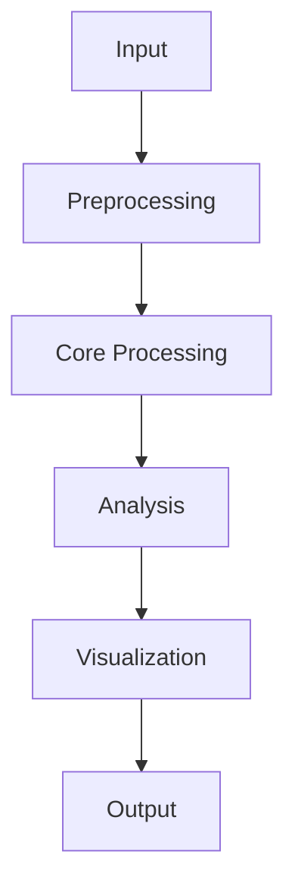

# 🚀 Project Name

<p align="center">
  
</p>

<p align="center">
  <b>A short and powerful description of your project</b>
</p>

<p align="center">
  
  
  
</p>

---

## 📌 Table of Contents

- [About the Project](#-about-the-project)
- [Features](#-features)
- [Project Architecture](#-project-architecture)
- [Technologies Used](#-technologies-used)
- [Installation](#-installation)
- [Usage](#-usage)
- [Results and Visualization](#-results-and-visualization)
- [Project Structure](#-project-structure)
- [Future Enhancements](#-future-enhancements)
- [Contributing](#-contributing)
- [License](#-license)
- [Contact](#-contact)

---

## 🎯 About the Project

Describe your project, its objectives, the problem it addresses, and its importance.

### Objectives
- Develop an effective solution.
- Improve efficiency and performance.
- Generate meaningful results.
- Provide an accessible and user-friendly workflow.

---

## ✨ Features

| Feature | Description |
|---|---|
| ⚡ Performance | Efficient processing |
| 📊 Visualization | Interactive data presentation |
| 🔍 Analysis | Detailed analysis |
| 🔒 Reliability | Consistent results |
| 🛠️ Customization | Flexible configuration |

---

## 🔄 Project Architecture



---

## 🧰 Technologies Used

<p align="center">
  
</p>

- Programming language: Python
- Version control: Git
- Repository: GitHub
- Development environment: VS Code

---

## ⚙️ Installation

Clone the repository:

```bash
git clone https://github.com/USERNAME/REPOSITORY.git
```

Navigate to the project directory:

```bash
cd REPOSITORY
```

Install dependencies:

```bash
pip install -r requirements.txt
```

---

## ▶️ Usage

Run the project:

```bash
python main.py
```

Modify the configuration according to your requirements.

---

## 📊 Results and Visualization

Add your project screenshots, experimental results, graphs, or performance charts here.

### Sample results

| Parameter | Result |
|---|---|
| Accuracy | Add value |
| Processing time | Add value |
| Performance | Add value |

### Project screenshots

<p align="center">
  
</p>

---

## 📁 Project Structure

```text
project/
│
├── README.md
├── main.py
├── requirements.txt
├── data/
├── images/
├── results/
└── src/
```

---

## 🚀 Future Enhancements

- Improve system performance.
- Add additional analytical features.
- Introduce interactive visualizations.
- Expand project functionality.

---

## 🤝 Contributing

Contributions are welcome!

1. Fork this repository.
2. Create a new branch.
3. Commit your changes.
4. Submit a pull request.

---

## 📜 License

This project is distributed under the MIT License. Update this section if you use a different license.

---

## 📬 Contact

**Project Developer:** Your Name

- GitHub: https://github.com/USERNAME
- Email: your-email@example.com

---

<p align="center">
  ⭐ If you find this project useful, please consider giving it a star!
</p>

<p align="center">
  
</p>
