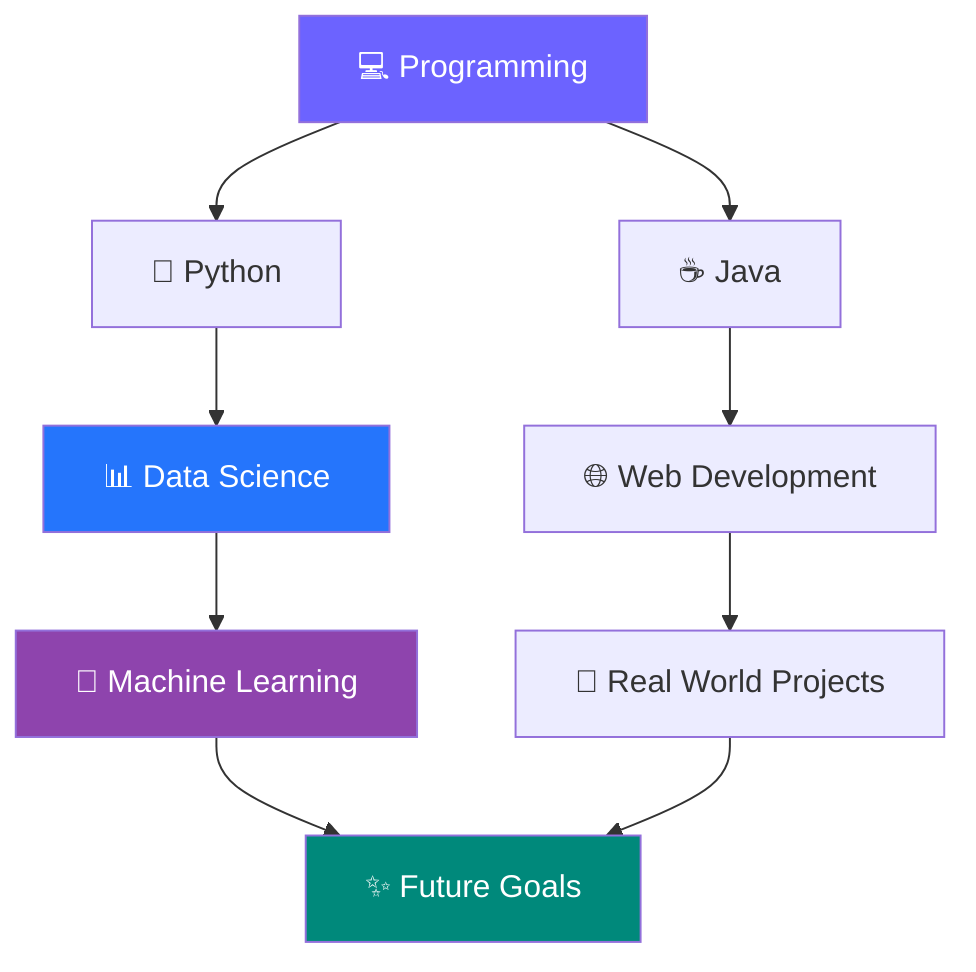

<!-- ✨ ANIMATED HEADER -->

  

<!-- ⌨️ TYPING ANIMATION -->

  

<h3 align="center">🚀 Welcome to my GitHub Universe!</h3>

  
  

---

## 🌸 About Me

Hello! I'm **Vennela**, a passionate Data Science student who loves exploring technology, programming, and creative web development.

💡 I believe in learning by building and turning ideas into real-world projects.

- 🎓 Data Science Student
- 🐍 Python and Java Programmer
- 🗄️ SQL and Database Enthusiast
- 🌐 Frontend Web Developer
- 💻 Developed 4–5 college-level websites
- 🏢 Built a website for EEE STRAIDS, Pragati University, Surampalem
- 🚀 Interested in Data Science, AI and Machine Learning

---

## ⚡ My Tech Stack

  

### 💻 Programming & Development

| Technology | Proficiency area |
|---|---|
| 🐍 Python | Programming and Data Science |
| ☕ Java | Object-oriented programming |
| 🗄️ SQL | Database queries |
| 🌐 HTML5 | Website structure |
| 🎨 CSS3 | Styling and layouts |
| 🔧 Git & GitHub | Version control |

---

## 🎨 What I Build

  
  
  

### 🌐 Featured Experience

**EEE STRAIDS – Pragati University, Surampalem**

- Developed a website for EEE STRAIDS.
- Worked on website structure and frontend design.
- Used HTML and CSS.
- Gained practical website development experience.

### 🎓 Academic Projects

- Developed 4–5 websites for college-level projects.
- Practiced frontend development.
- Applied programming concepts to practical projects.

---

---

## 🌱 My Learning Roadmap

## 🎯 2026 Goals

- [ ] Improve Python programming.
- [ ] Master SQL and database concepts.
- [ ] Build Data Science projects.
- [ ] Learn Machine Learning.
- [ ] Develop more advanced websites.
- [ ] Contribute to open-source projects.

---

## 🌐 Connect With Me

  

---

<h3 align="center">💜 Thanks for Visiting My Profile!</h3>

  <i>"Dream. Code. Create. Repeat."</i>

  

